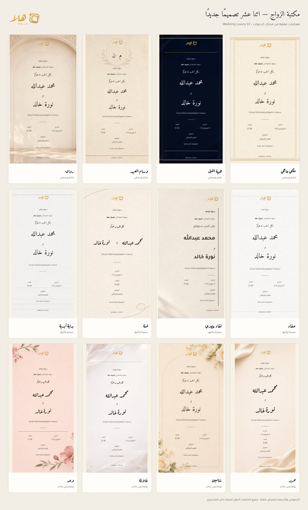

# HALA | هلا — تقرير توسعة قوالب الزواج V2

أُضيف **12 قالب زواج جديدًا** إلى رحلة هلا الفعلية، ليصبح قسم الزواج **16 قالبًا** مع الاحتفاظ بالقوالب الأربعة السابقة. لكل قالب جديد خلفيته وتوزيعه ومعرّفه الثابت، مع تخصيص محفوظ وعرض مطابق في رابط الضيف.

الفرع: `feature/hala-wedding-luxury-v2-20261107`. قاعدة التنفيذ: `main` عند الالتزام `5f4be889c3e905761b4f11c0f47dca302a73e092`، المطابق لآخر إنتاج ناجح وقت التدقيق. لا يتضمن هذا التحديث دمجًا في `main` أو نشرًا للإنتاج.

- [طلب المراجعة رقم 23](https://github.com/Noortoona/noortoona/pull/23)
- [معاينة مكتبة الزواج على Netlify](https://deploy-preview-23--noortoona.netlify.app/#templates)
- [فحوص GitHub للالتزام الحالي](https://github.com/Noortoona/noortoona/pull/23/checks)

## صور القوالب

| القالب | الاسم الإنجليزي | المجموعة | التصنيفات | المعاينة الكاملة |
| --- | --- | --- | --- | --- |
| ملكي عاجي | Ivory Royal | فخم ورسمي | فخم، رسمي، مختارات هلا | [الصورة](previews/ivory-royal.jpg) |
| هيبة الليل | Midnight Prestige | فخم ورسمي | فخم، رسمي، مختارات هلا | [الصورة](previews/midnight-prestige.jpg) |
| وسام العهد | Signature Monogram | فخم ورسمي | فخم، رسمي | [الصورة](previews/signature-monogram.jpg) |
| رواق | Grand Hall | فخم ورسمي | فخم، رسمي | [الصورة](previews/grand-hall.jpg) |
| صفاء | Pure Elegance | بسيط وأنيق | بسيط، مختارات هلا | [الصورة](previews/pure-elegance.jpg) |
| نقاء عصري | Modern Minimal | بسيط وأنيق | بسيط | [الصورة](previews/modern-minimal.jpg) |
| لمسة | Fine Touch | بسيط وأنيق | بسيط | [الصورة](previews/fine-touch.jpg) |
| بداية أبدية | Timeless | بسيط وأنيق | بسيط، رسمي | [الصورة](previews/timeless.jpg) |
| حرير | Silk Romance | رومانسي فاخر | رومانسي، فخم | [الصورة](previews/silk-romance.jpg) |
| شامبين | Champagne Bloom | رومانسي فاخر | رومانسي، فخم، مختارات هلا | [الصورة](previews/champagne-bloom.jpg) |
| غلالة | Pearl Veil | رومانسي فاخر | رومانسي، فخم، رسمي | [الصورة](previews/pearl-veil.jpg) |
| وعد | Eternal Promise | رومانسي فاخر | رومانسي، فخم | [الصورة](previews/eternal-promise.jpg) |

«وسام العهد» و«نقاء عصري» و«بداية أبدية» تتجنب تكرار أسماء موجودة في أقسام التكريم والخطوبة والتخرج. «مختارات هلا» اختيار تحريري، ولم يُضف تصنيف «الأكثر طلبًا» أو إحصاءات استخدام مفترضة.

## نتيجة التدقيق الأولي

| العنصر | ما وُجد وكيف جرى التعامل معه |
| --- | --- |
| أحدث نسخة مستقرة | رأس `main` يطابق إنتاج Netlify الناجح `6aef770f25f3537059841022`؛ بدأ الفرع منه، وبقي تحديث جهات الاتصال الأخير محفوظًا. |
| قوالب الزواج السابقة | `wedding:ليلة كحلية`، `wedding:حديقة اللؤلؤ`، `wedding:أقواس ذهبية`، `wedding:مخمل ملكي`. |
| الصور السابقة | `assets/templates/atlas-social.webp`، الصف الثالث من أطلس 4 × 5. المواضع بقيت `0% 50%`، `33.333% 50%`، `66.667% 50%`، `100% 50%`. |
| التخصيص السابق | خط وخلفية وصوت ولون رئيسي محفوظة في `design_json`؛ اختيارات القوالب تستعمل الاسم، وإخفاء القوالب يستعمل `group:name`. |
| الهوية الرسمية | ملفات `assets/brand/` والألوان النهائية في CSS و`mobile/src/theme.ts` تعتمد الكحلي الداكن والذهبي الدافئ. لم يُعدّل الشعار أو أصول الهوية. |
| البناء والنشر | `netlify.toml` يشغّل `scripts/build-static.mjs` وينشر `dist`. جرى تضمين `wedding.css` وفحص تزامن الكتالوج في البناء نفسه، مع بقاء قائمة الملفات العامة المعزولة. |
| Expo | كان يملك كتالوجًا مستقلًا وصور أطالس مضمّنة؛ عُدّل صراحةً، وأضيفت الصور المصغرة المضمّنة وبيانات التصميم ومصدر المعاينة المتزامن. |

## التخصيص والربط

- تعديل اسم العريس والعروس، عنوان الدعوة، العبارة الترحيبية، النص، التاريخ، الوقت، الموقع والملاحظات.
- ثلاثة خطوط عربية مرخّصة ومستضافة محليًا: أميري، عارف رقعة، وتجوال.
- ألوان نص مقيدة بلوحات تحقق تباينًا لا يقل عن 4.5:1 مع منطقة القراءة، ولون منفصل للتفاصيل الزخرفية.
- محاذاة وسط/يمين في التصاميم الداعمة، وإظهار/إخفاء الزخارف الإضافية. مونوغرام «وسام العهد» يتحدث مع الاسمين.
- خلفية مخصصة في تسعة قوالب. تحتفظ «رواق» و«شامبين» و«وعد» بخلفياتها المتكاملة. يُفحص MIME وتوقيع الملف وحجمه وأبعاده، وتُرفض SVG والملفات المزيفة والأبعاد فوق 20 ميجابكسل. يعاد ترميز صورة الويب قبل الحفظ.
- تتحدث المعاينة أثناء التحرير دون استبدال صورة الخلفية أو محرّر الحقول عند كل حرف. تتوفر معاينة جوال ونسخة كاملة، مع إغلاق وتركيز صحيحين بلوحة المفاتيح.
- تُحفظ المسودة والنصوص والملفات المختارة محليًا، وتُستعاد بعد إعادة التحميل. يظهر تنبيه واضح إذا تعذّر الحفظ بسبب مساحة المتصفح.
- يُرسل الاسم المقروء مع `design.templateId` الثابت بصيغة `wedding-v2-<slug>` و`templateVersion: 2` إلى `POST /api/events`، ثم إلى `events.template` و`events.design_json` بالطريقة القائمة.
- يتحقق الخادم من تطابق الاسم والمعرّف ومن إتاحة القالب. يستخدم المدعو محرّك العرض ذاته، مع إبقاء QR وGoogle Maps وRSVP وروابط الضيوف ونظام الحجز الحالي.
- تبقى الدعوات القديمة على أطالسها وأسمائها السابقة. المعرّف غير المعروف لا يمحو البيانات المحفوظة؛ العرض يستطيع الرجوع إلى الاسم المعروف أو الرسم القديم الآمن، بينما يرفض إنشاء دعوة جديدة بمعرّف V2 مجهول أو متعارض.

الأسعار وحدود المدعوين ومنطق تحصيل الدفع وإدارة الضيوف لم تتغير. رحلة الموقع الحالية تسجل طلب حجز بانتظار استكمال الدفع؛ لا يعرض هذا التحديث الطلب على أنه مبلغ محصّل.

## الملفات والأصول

| الملفات | الغرض |
| --- | --- |
| `shared/wedding-templates.json` | المصدر المؤلف الوحيد لبيانات القوالب الجديدة وتصنيفاتها وقدراتها. |
| `scripts/sync-wedding-templates.mjs` | توليد وفحص إسقاط بيانات الويب وExpo والصور المصغرة المضمّنة. |
| `invitation-renderer.js` | الإسقاط المولد، معرّفات ثابتة، 12 توزيعًا، مونوغرام، تلوين آمن وتنسيق تاريخ عربي. |
| `app.js`، `index.html`، `guest.html`، `wedding.css` | المعرض والفلاتر والاختيار والتخصيص والمعاينة والخطوط المحلية. |
| `assets/templates/wedding-v2/*` | 60 أصلًا حقيقيًا: رئيسي، جوال، مصغر، وبديلان JPEG لكل قالب. |
| `assets/fonts/*` | ستة ملفات WOFF2 وثلاثة تراخيص OFL. |
| `netlify/functions/_shared/template-registry.mjs` | إضافة القوالب إلى سجل إتاحة الخادم دون تغيير مفاتيح القوالب السابقة. |
| `netlify/functions/_shared/wedding-design.mjs`، `image-metadata.mjs`، `create-event.mts` | تطبيع التصميم والتحقق من المعرّف والملف والأبعاد قبل التخزين. |
| `mobile/src/templateCatalog.ts`، `weddingTemplates.ts`، `weddingAssets.ts`، `templates.tsx` | كتالوج Expo المتزامن والصور المضمّنة. |
| `mobile/app/(customer)/customer/create.tsx` | اختيار القوالب الجديدة وتخصيصها وإرسال معرّفها وحقولها للخادم. |
| `mobile/src/InvitationPreview.tsx`، `invitationSource.ts`، `mobile/scripts/sync-invitation-preview.mjs` | نفس محرّك الويب وCSS، مع ارتفاع معاينة يتكيف مع النص. |
| `mobile/assets/templates/wedding-v2/*`، `mobile/tsconfig.json` | 12 صورة JPEG مضمّنة وتوافق فحص TypeScript واختبارات Node. |
| `mobile/package.json`، `mobile/package-lock.json` | خمس ترقيات تصحيحية مطلوبة لتوافق Expo SDK 57: Expo 57.0.32، Constants 57.0.23، Image Picker 57.0.21، Router 57.0.30، Splash Screen 57.0.11. |
| `scripts/build-static.mjs`، `package.json`، إعدادات Playwright وسير عمل GitHub | البناء المعزول وفحوص المصدر والرحلات عبر المحركين. |
| `tests/wedding-templates.mjs`، `tests/e2e/wedding-v2.spec.js`، تعديلات الاختبارات الحالية | أمان وأداء وتوافق وحفظ فعلي ودعوات قديمة وحدود العرض. |
| `docs/wedding-v2/*`، `scripts/capture-wedding-previews.mjs`، `scripts/check-wedding-preview.mjs` | التقرير والأصول والمعاينات، وفحص دعوات تجريبية محفوظة على Netlify بمعزل عن الإنتاج. |

## الاختبارات المحلية المنفذة

| الفحص | النتيجة |
| --- | --- |
| `npm test` | ناجح: فحص smoke، و112 اختبارًا مسجلًا عبر مجموعات الخادم والبناء والأمان والبيانات والكتالوج والحجز والقوالب. |
| اختبارات رحلات الموقع السابقة | ناجحة: 9/9، بما فيها نشاط بادل، حفظ حجز في PostgreSQL معزول، QR يدوي/كاميرا، RSVP وحالات إرسال واتساب المحاكية. |
| رحلات Wedding V2 | ناجحة: 64/64 عبر Chromium مكتبي ومحاكاة Android وWebKit بمحاكاة iPhone ومكتبي. |
| التغطية الجديدة | إنشاء وحفظ واستعادة كل قالب وفتح دعوة ضيف فعلية من قاعدة معزولة؛ أسماء طويلة؛ معرض وفلاتر؛ فشل الصور؛ لوحة مفاتيح؛ حركة مخفضة؛ تحميل الصور المصغرة؛ رفع صورة وحفظها؛ رفض المزيف؛ كل التصاميم بعرض 320 بكسل؛ بقاء الخط عند العودة إلى قالب قديم. |
| TypeScript للخادم | ناجح. |
| TypeScript للتطبيق | ناجح. |
| اختبارات التطبيق | ناجحة: 11/11. |
| Expo Doctor | ناجح: 21/21. |
| Expo native prebuild | ناجح لـ iOS وAndroid دون تثبيت تبعيات أو توقيع إصدار إنتاج. |
| تجميع JavaScript/Hermes | ناجح لـ iOS وAndroid. |
| فحص التزامن والبناء | ناجح؛ الإسقاطات ومصدر المعاينة متطابقة مع المصادر، والخادم والاختبارات لا تدخل مجلد النشر العام. |

كان فحص العرض الأول قد كشف تنسيق تاريخ غير مناسب وتأثير تنسيق footer العام؛ أُصلحا قبل الدورة النهائية. جرى أيضًا ضبط اختبارات الألوان لتستعمل صيغة color input القياسية، وفصل مجلدات نتائج Playwright لتجنب تداخلها، وإبقاء «أميري» ظاهرًا في محرّر القوالب القديمة عند الانتقال إليها. طلب أول فحص Expo في GitHub تحديث الحزم الخمس المذكورة أعلاه؛ جرى تحديثها وإعادة فحص الأنواع والاختبارات وDoctor والبناء والتجميع. لا توجد اختبارات محلية فاشلة في الدورات النهائية المذكورة أعلاه.

## فحص المعاينة المنشورة

قاعدة بيانات معاينة Netlify منفصلة باسم فرع التطوير، وليست `production`. فحص المعاينة يستعمل أحداثًا وضيوفًا اصطناعيين فقط، ولا ينشئ حجوزات أو مدفوعات أو يرسل رسائل. يتحقق من القوالب في المعرض ثم من الدعوات المحفوظة عبر مسار `/i/:code`، ومن QR وخرائط Google ومن ثبات الباقات قبل الفحص وبعده. توجد روابط الدعوات التجريبية ونتيجة الفحص المباشر النهائية في وصف طلب السحب.

يحاول إطار Netlify المساعد في المعاينة التحميل من `app.netlify.com`، وتمنعه CSP القائمة؛ لم تُخفف السياسة للسماح به. يسجّل فحص المعاينة هذا التحذير المعروف منفصلًا عن أخطاء تطبيق هلا، وتقتصر تهيئة التخزين المحلية للاختبار على الإطار الرئيسي.

## الأداء والأمان

حجم نسخ الخلفيات الستين معًا نحو 2.78 MB؛ أكبر صورة مصغرة WebP نحو 5.6 KB، وأكبر نسخة جوال نحو 23.4 KB. لا تُحمّل الصور الأصلية عند فتح المعرض، ويُحمّل الأصل عند المعاينة فقط. تستخدم الصور المصغرة `loading="lazy"` و`decoding="async"` مع مساحة محفوظة وبديل JPEG ورسالة فشل مفهومة. الخطوط WOFF2 محلية، ولا تحتاج صفحات الإنشاء والدعوة إلى Google Fonts.

النصوص تُهرب قبل HTML، وألوان التصميم لا تتحول إلى CSS حر، والخلفيات المرفوعة صور raster محدودة الحجم والأبعاد. تبقى سياسة CSP الحالية كما هي؛ الأصول من نفس الموقع، ولا توجد معالجات أحداث inline أو روابط صور تجريبية أو استدعاءات شبكة لإنتاج QR.

## حدود المراجعة وما لم يُنفذ

- اختبارات iPhone وAndroid والمكتبي المذكورة هي محاكاة متصفح. لم يُنفذ اختبار على أجهزة iPhone/Android فعلية أو Safari أصلي على macOS.
- بُنيت حزم Expo وفُحص المصدر، لكن لم يُصدر APK أو TestFlight جديد لهذا التحديث؛ التطبيقات المثبتة سابقًا تحتاج إصدارًا جديدًا للحصول على الكتالوج والصور المضمّنة. يجب أن يشير الإصدار التجريبي إلى خلفية Netlify التي تضم الأصول والخادم الجديدين.
- لم تُنفذ عملية تحصيل أموال حقيقية أو إرسال واتساب إلى مدعو حقيقي. اختبارات الدفع والمراسلة تستخدم الاختبارات الحالية والبيئة المعزولة.
- المعاينات المرفقة هي مرجع المراجعة البصرية الأول؛ لم يقدم مرجع معتمد لإجراء مقارنة تلقائية بالبكسل.
- لا دمج ولا نشر إنتاج ضمن هذا التنفيذ. حالة فحوص GitHub ومعاينة Netlify الفعلية وروابطهما تؤخذ من طلب السحب، وتُراجع قبل اعتماد الإنتاج.

تفاصيل إنتاج الصور وتراخيص الخطوط: [مصادر الأصول](ASSETS.md).
